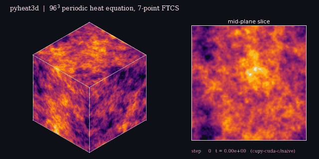
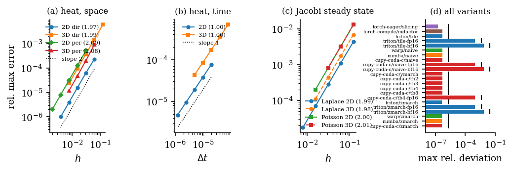
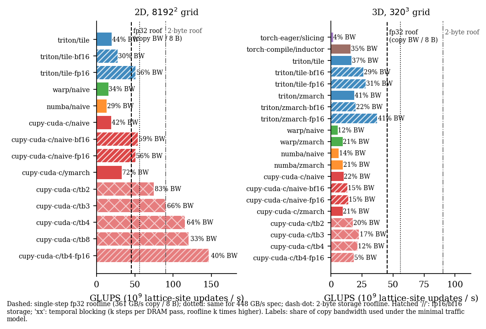
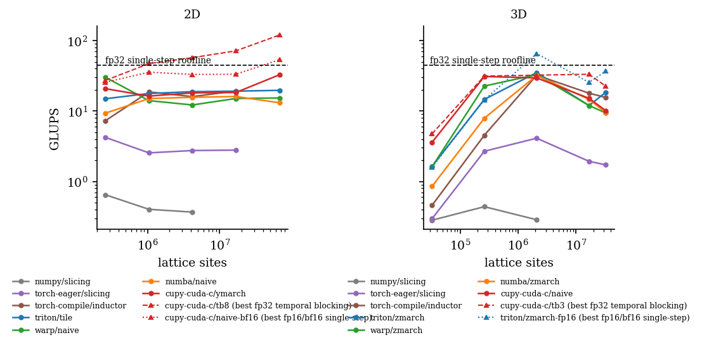

# pyheat3d

**The explicit heat equation and Jacobi iteration (5-point 2D, 7-point 3D stencil) at the GPU
memory roofline, from Python: seven backends, one interface, validated against analytic
solutions.**

[](https://github.com/walidhemati/pyheat3d/actions/workflows/ci.yml)
[](LICENSE)
[](pyproject.toml)
[](paper/paper.pdf)



## Headline result

<!-- headline:start -->
> **Provisional numbers** (`results/dev-provisional.json`, measured on a shared GPU during development; the final numbers come from `bench/run.py --full` on an idle GPU).
>
> **3D 320^3, single step:** `triton/zmarch` **18.5 GLUPS** = 148 GB/s = **41% of the 361 GB/s copy bandwidth** (33% of the 448 GB/s spec).<br>
> **3D temporal blocking (k=3):** `cupy-cuda-c/tb3` **22.5 GLUPS**, 0.50x the single-step roofline of 45.1 GLUPS while moving an estimated 60 GB/s (minimal model) to 80 GB/s (with halo over-fetch) of DRAM traffic. The roofline per step drops k-fold; the hardware is not beaten.<br>
> **2D 8192^2, single step:** `cupy-cuda-c/ymarch` **32.7 GLUPS** = 262 GB/s = **72% of the 361 GB/s copy bandwidth** (58% of the 448 GB/s spec).<br>
> **2D temporal blocking (k=8):** `cupy-cuda-c/tb8` **120.1 GLUPS**, 2.66x the single-step roofline of 45.1 GLUPS while moving an estimated 120 GB/s (minimal model) to 145 GB/s (with halo over-fetch) of DRAM traffic. The roofline per step drops k-fold; the hardware is not beaten.<br>
> NVIDIA GeForce RTX 3070 Laptop GPU, 2026-10-09.
<!-- headline:end -->

The stencil is the canonical memory-bound kernel: about 1 FLOP per byte of DRAM traffic.
Throughput is reported in lattice-site updates per second (GLUPS). Bandwidth comes from the
*minimal* traffic model: one read and one write per site per DRAM pass, so 8 B per fp32
update, 4 B for fp16/bf16 storage, and 8/k B when k time steps are fused per pass. The model
cannot inflate an inefficient kernel. Percentages are relative to the measured 361 GB/s
device-to-device copy bandwidth (and the 448 GB/s spec) of an RTX 3070 Laptop GPU.

**About temporal blocking.** The `tb<k>` variants fuse k time steps into one sweep over
memory. Each update then needs k times less DRAM traffic, so the roofline *per update* is k
times higher. Their lattice-update rate can exceed the single-step roofline (45 GLUPS for fp32)
while the actual DRAM traffic stays below the copy bandwidth. For every such run we report the
update rate, the estimated DRAM traffic (minimal model and a halo-over-fetch model), and the
"single-step-equivalent" bandwidth. The last one is not a DRAM rate.

## What's inside

| backend | variants | dims | notes |
|---|---|---|---|
| `numpy` | `slicing` | 2D, 3D | CPU reference and correctness oracle, any float dtype, Poisson source |
| `torch-eager` | `slicing` | 2D, 3D | NumPy-style slicing on the GPU (fp64 capable) |
| `torch-compile` | `inductor` | 2D, 3D | the same expression fused by `torch.compile` |
| `triton` | `tile`, `zmarch` (+ `-fp16`, `-bf16`) | 2D, 3D / 3D | tiled kernels; 2.5D z-marching with a register queue |
| `warp` | `naive`, `zmarch` | 2D, 3D / 3D | NVIDIA Warp kernels with pre-recorded launches |
| `numba` | `naive`, `zmarch` | 2D, 3D / 3D | Numba-CUDA kernels |
| `cupy-cuda-c` | `naive` (+ fp16/bf16), `zmarch`, `ymarch`, `tb2`, `tb3`, `tb4`, `tb8`, `tb4-fp16` | 2D, 3D | hand-written CUDA C compiled at run time by NVRTC: 2.5D blocking, temporal blocking |

Physics and numerics: explicit FTCS for `u_t = alpha lap(u)` with the stability limit
`r = alpha dt / h^2 <= 1/(2d)` enforced; Dirichlet (fixed boundary layer) and periodic
boundaries; Jacobi iteration for Laplace and Poisson (`--mode jacobi`). Every kernel implements
`u' = c0 u + c1 S` with the same summation order, so the backends agree to round-off.

## Quick start

```bash
pip install -e .[gpu]          # or .[dev] for the CPU-only reference + tests
pyheat3d list                  # variants and whether they run here
pyheat3d run --variant cupy-cuda-c/tb4 --dims 3 --n 256 --steps 400
pyheat3d validate --quick      # convergence orders + cross-backend agreement
python bench/run.py --quick    # < 2 min benchmark smoke run
```

## Validation



<!-- validation:start -->
- Heat equation, decaying sine mode vs the exact PDE solution: observed spatial order 1.97 (2D) / 1.99 (3D) with Dirichlet walls, 2.00 / 2.08 periodic; temporal order 1.00 / 1.00 against the exact-in-time semi-discrete solution.
- Jacobi steady states: Laplace order 1.99 (2D) / 1.98 (3D), Poisson (manufactured) 2.00 / 2.01; a quadratic harmonic function (on which the stencil is exact) is recovered to 5.3e-15.
- Cross-backend: 76/76 comparisons of 23 variants against the NumPy reference pass; worst fp32 relative deviation 5.1e-7 (FMA contraction only). fp16/bf16 variants are checked against a reference that applies the same storage rounding.
<!-- validation:end -->

References: (a) the exact PDE solution of a decaying sine mode, (b) its semi-discrete
(exact-in-time) solution, (c) the fully discrete FTCS solution, which every backend reproduces
to round-off, (d) analytic harmonic functions and a manufactured Poisson solution, (e) a NumPy
oracle on random fields with both boundary conditions (`tests/test_backends.py` checks
every variant, including grids smaller than one tile and step counts that are not a multiple of
k).

## Performance





<!-- perf-table:start -->
| dims | variant | storage | k | GLUPS | B/update | GB/s | % copy | % spec |
|---|---|---|---:|---:|---:|---:|---:|---:|
| 3D 320^3 | `triton/zmarch-fp16` | float16 | 1 | 36.95 | 4 | 148 | 41 | 33 |
| 3D 320^3 | `triton/tile-fp16` | float16 | 1 | 27.83 | 4 | 111 | 31 | 25 |
| 3D 320^3 | `triton/tile-bf16` | bfloat16 | 1 | 25.97 | 4 | 104 | 29 | 23 |
| 3D 320^3 | `cupy-cuda-c/tb3` | float32 | 3 | 22.48 | 2.7 | 60 | 17 | 13 |
| 3D 320^3 | `cupy-cuda-c/tb4` | float32 | 4 | 21.24 | 2 | 42 | 12 | 9 |
| 3D 320^3 | `triton/zmarch-bf16` | bfloat16 | 1 | 19.76 | 4 | 79 | 22 | 18 |
| 3D 320^3 | `triton/zmarch` | float32 | 1 | 18.48 | 8 | 148 | 41 | 33 |
| 3D 320^3 | `cupy-cuda-c/tb4-fp16` | float16 | 4 | 18.26 | 1 | 18 | 5 | 4 |
| 3D 320^3 | `cupy-cuda-c/tb2` | float32 | 2 | 17.72 | 4 | 71 | 20 | 16 |
| 3D 320^3 | `triton/tile` | float32 | 1 | 16.63 | 8 | 133 | 37 | 30 |
| 3D 320^3 | `torch-compile/inductor` | float32 | 1 | 15.60 | 8 | 125 | 35 | 28 |
| 3D 320^3 | `cupy-cuda-c/naive-fp16` | float16 | 1 | 13.94 | 4 | 56 | 15 | 12 |
| 3D 320^3 | `cupy-cuda-c/naive-bf16` | bfloat16 | 1 | 13.14 | 4 | 53 | 15 | 12 |
| 3D 320^3 | `cupy-cuda-c/naive` | float32 | 1 | 10.12 | 8 | 81 | 22 | 18 |
| 3D 320^3 | `numba/zmarch` | float32 | 1 | 9.50 | 8 | 76 | 21 | 17 |
| 3D 320^3 | `cupy-cuda-c/zmarch` | float32 | 1 | 9.43 | 8 | 75 | 21 | 17 |
| 3D 320^3 | `warp/zmarch` | float32 | 1 | 9.39 | 8 | 75 | 21 | 17 |
| 3D 320^3 | `numba/naive` | float32 | 1 | 6.23 | 8 | 50 | 14 | 11 |
| 3D 320^3 | `warp/naive` | float32 | 1 | 5.36 | 8 | 43 | 12 | 10 |
| 3D 320^3 | `torch-eager/slicing` | float32 | 1 | 1.72 | 8 | 14 | 4 | 3 |
| 2D 8192^2 | `cupy-cuda-c/tb4-fp16` | float16 | 4 | 146.16 | 1 | 146 | 40 | 33 |
| 2D 8192^2 | `cupy-cuda-c/tb8` | float32 | 8 | 120.13 | 1 | 120 | 33 | 27 |
| 2D 8192^2 | `cupy-cuda-c/tb4` | float32 | 4 | 115.42 | 2 | 231 | 64 | 52 |
| 2D 8192^2 | `cupy-cuda-c/tb3` | float32 | 3 | 89.94 | 2.7 | 240 | 66 | 54 |
| 2D 8192^2 | `cupy-cuda-c/tb2` | float32 | 2 | 74.60 | 4 | 298 | 83 | 67 |
| 2D 8192^2 | `cupy-cuda-c/naive-bf16` | bfloat16 | 1 | 53.52 | 4 | 214 | 59 | 48 |
| 2D 8192^2 | `triton/tile-fp16` | float16 | 1 | 50.74 | 4 | 203 | 56 | 45 |
| 2D 8192^2 | `cupy-cuda-c/naive-fp16` | float16 | 1 | 50.43 | 4 | 202 | 56 | 45 |
| 2D 8192^2 | `cupy-cuda-c/ymarch` | float32 | 1 | 32.72 | 8 | 262 | 72 | 58 |
| 2D 8192^2 | `triton/tile-bf16` | bfloat16 | 1 | 27.50 | 4 | 110 | 30 | 25 |
| 2D 8192^2 | `triton/tile` | float32 | 1 | 19.69 | 8 | 158 | 44 | 35 |
| 2D 8192^2 | `cupy-cuda-c/naive` | float32 | 1 | 19.10 | 8 | 153 | 42 | 34 |
| 2D 8192^2 | `warp/naive` | float32 | 1 | 15.36 | 8 | 123 | 34 | 27 |
| 2D 8192^2 | `numba/naive` | float32 | 1 | 13.14 | 8 | 105 | 29 | 23 |

Source: `results/dev-provisional.json` (provisional). GB/s uses the minimal traffic model (2 x bytes per value / k per update), so it is a lower bound on real DRAM traffic.
<!-- perf-table:end -->

## How it works

1. **NumPy / torch eager.** Slicing expressions; each operator is a full pass over memory.
2. **`torch.compile`.** The same Python expression becomes one fused kernel: one read and one
   write per site.
3. **Triton, Warp, Numba, CUDA C (naive).** One kernel, neighbours reused through L1/L2.
4. **2.5D blocking (`zmarch`).** A block owns an xy tile and marches in z. The z neighbours
   live in a register queue and the plane sits in shared memory (Micikevicius 2009).
5. **Temporal blocking (`tb<k>`).** A wavefront in (z, t): stage s of the pipeline advances
   the plane behind stage s-1 by one more time level, entirely in registers and shared memory or
   warp shuffles. Halos are recomputed redundantly (overlapped tiling) and only the centre of
   each tile is written, once per k steps. The 2D kernel is warp-synchronous, with no shared
   memory and no barriers.
6. **fp16/bf16 storage.** 2 B per value with fp32 arithmetic: half the traffic, but visibly
   less accurate on long diffusive runs (see the paper).

## Reproduce the paper

```bash
python bench/roofline.py                         # measure copy bandwidth + FP32 FMA peak
python bench/run.py --full                       # ~15 min on an idle GPU -> results/rtx3070-laptop.json
pyheat3d validate --out results/validation.json  # convergence studies (GPU recommended)
python figures/make_figures.py                   # figures, paper/results.tex, README blocks
python figures/make_hero.py                      # docs/media/hero.gif
cd paper && tectonic paper.tex                   # paper/paper.pdf
```

## Citation

```bibtex
@software{hemati2026pyheat3d,
  author  = {Hemati, Walid},
  title   = {pyheat3d: explicit heat-equation and Jacobi stencils at the GPU memory roofline, from Python},
  year    = {2026},
  version = {0.1.0},
  url     = {https://github.com/walidhemati/pyheat3d}
}
```

See [CITATION.cff](CITATION.cff). Released under the [MIT license](LICENSE).

---

Part of the **Python-HPC suite**:
[pylbm](https://github.com/walidhemati/pylbm) ·
[pyheat3d](https://github.com/walidhemati/pyheat3d) ·
[pygravity](https://github.com/walidhemati/pygravity) ·
[pymd](https://github.com/walidhemati/pymd) ·
[pyising](https://github.com/walidhemati/pyising) ·
[pyspectral](https://github.com/walidhemati/pyspectral)
